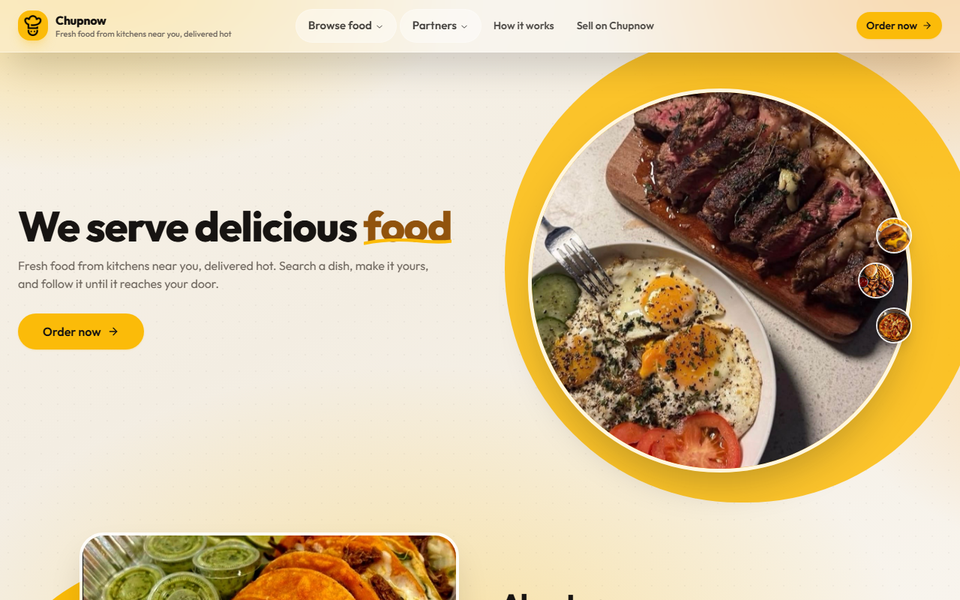
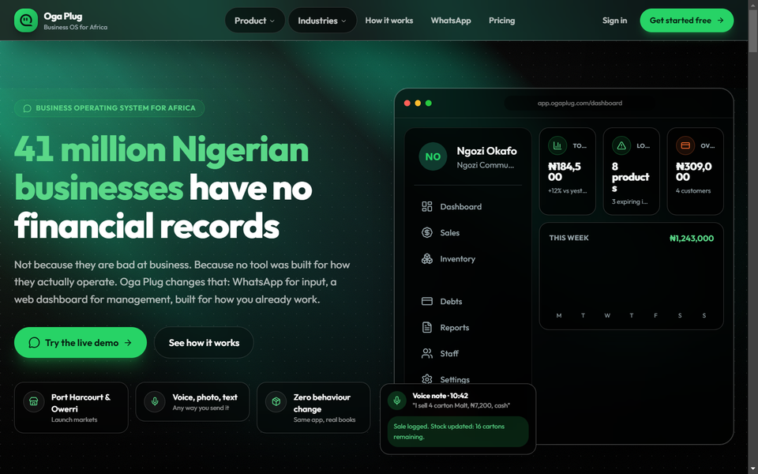
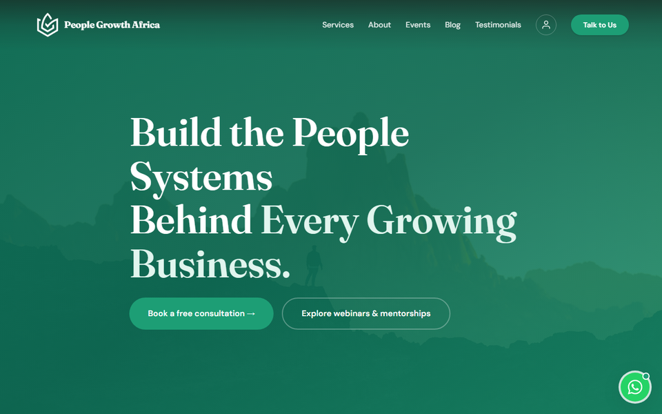
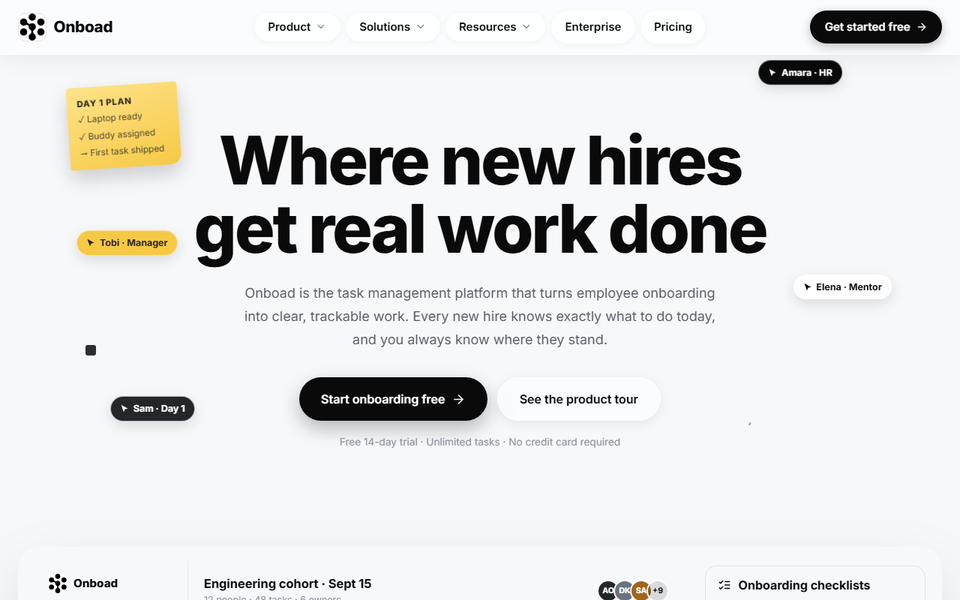

<div align="center">



<br/>

<a href="mailto:israeliraoya7@gmail.com"></a>
<a href="https://www.linkedin.com/in/israel-iraoya-a556a9316"></a>
<a href="https://github.com/izzychils"></a>


</div>

<br/>

> **Software engineer who ships.** I build full-stack products: React and TypeScript on the front, Node and Python APIs behind it, SQL underneath. Then I get them live, fast, and usable by real people.
>
> *Hiring? Every project card below links to a running deployment.*


## `01` / About

I'm a Software Engineering graduate from **Babcock University** and a **Technology & Systems Associate at [People Growth Africa](https://www.peoplegrowthafrica.com/)**, where I build the web applications, APIs and internal tools the company runs on.

I like the whole pipeline: the interface someone enjoys using, the API contract behind it, the schema that keeps it honest, and the deploy that puts it in front of people.

```ts
const israel = {
  role:      "Technology & Systems Associate @ People Growth Africa",
  based:     "Uyo, Nigeria · remote-friendly",
  stack:     ["React", "TypeScript", "Node.js", "Python", "SQL"],
  focus:     ["product UI", "REST APIs", "auth flows", "cloud deploys"],
  openTo:    "full-stack engineering roles",
  currently: "shipping internal systems + going deeper on systems design",
};
```

- **End-to-end ownership.** I've taken products from an empty repo to a live Vercel/Render deployment: routing, state, auth, API integration and the CSS in between.
- **Interfaces that feel fast.** Virtualised tables, motion that means something, and PWA shells that keep working on a shaky connection.
- **Data you can trust.** Normalised schemas, typed contracts and boring, predictable backend behaviour.


## `02` / Stack

<div align="center">


<br/><br/>


</div>


## `03` / Selected work

<table>
<tr>
<td width="50%" valign="top" align="center">
<a href="https://fds-fe-lac.vercel.app"></a>
<br/>
<h3>Chupnow / food delivery</h3>
<p align="left">A multi-vendor ordering PWA: browse independent kitchens, build an order with proteins and extras, then follow it to the door. Customer, vendor and admin surfaces share one typed store.</p>
<p align="left"><sub><b>React 19</b> · TypeScript · Zustand · Tailwind · Vite · PWA</sub></p>
<p align="left"><a href="https://fds-fe-lac.vercel.app"><b>Live demo →</b></a> &nbsp;·&nbsp; <a href="https://github.com/izzychils/fds-fe">Code</a></p>
</td>
<td width="50%" valign="top" align="center">
<a href="https://oga-plug.vercel.app"></a>
<br/>
<h3>Oga Plug / business OS</h3>
<p align="left">A business OS for African SMEs: owners log sales through WhatsApp voice notes, receipt photos or text, and the dashboard turns that into clean books, credit-readiness and theft signals. I built the web surface and dashboard UI.</p>
<p align="left"><sub><b>React 19</b> · TypeScript · Tailwind · Framer Motion</sub></p>
<p align="left"><a href="https://oga-plug.vercel.app"><b>Live demo →</b></a> &nbsp;·&nbsp; <a href="https://github.com/izzychils/oga-plug">Code</a></p>
</td>
</tr>
<tr>
<td width="50%" valign="top" align="center">
<a href="https://www.peoplegrowthafrica.com"></a>
<br/>
<h3>People Growth Africa / web platform</h3>
<p align="left">The current site for an HR consultancy, plus the client flows behind it: JWT sessions, a Neon Postgres lead pipeline, rate-limited endpoints and transactional email, all serverless on Vercel.</p>
<p align="left"><sub><b>React</b> · Neon Postgres · Upstash · Resend · Vercel Functions</sub></p>
<p align="left"><a href="https://www.peoplegrowthafrica.com"><b>Live site →</b></a> &nbsp;·&nbsp; <sub>Client work, private repo</sub></p>
</td>
<td width="50%" valign="top" align="center">
<a href="https://tms-fe-snowy.vercel.app"></a>
<br/>
<h3>Onboard / employee onboarding</h3>
<p align="left">An onboarding portal for new hires: role-aware dashboards, animated progress rings, document checklists and a manager view that shows exactly who is stuck at which step.</p>
<p align="left"><sub><b>React</b> · TypeScript · React Router · Framer Motion · Tailwind</sub></p>
<p align="left"><a href="https://tms-fe-snowy.vercel.app"><b>Live demo →</b></a> &nbsp;·&nbsp; <a href="https://github.com/izzychils/tms-fe">Code</a></p>
</td>
</tr>
</table>

### More in the lab

- **🎤 Glitter Mic**: multiplayer karaoke game with real-time voice scoring (Deepgram), Spotify-style word-by-word lyric reveal, Redis-backed sessions and an npm-workspaces monorepo. → [Code](https://github.com/izzychils/glitter-mic)
- **🛍️ Shopperly**: marketing site for an AI website builder, built around scroll-driven motion and a layout that holds up from phone to ultrawide. → [Live](https://shopperly-fe.vercel.app) · [Code](https://github.com/izzychils/shopperly-fe)
- **🎟️ Iventverse**: event platform for parties, weddings and conferences, with Next.js App Router, TanStack Query, Paystack checkout, a PWA shell and an admin console. *Client work, private repo.* → [Live](https://iventverse.com)
- **🤖 AI CV Generator (Mango-HR)**: AI-powered resume builder with chat-driven intake, authentication flows, API integration and an admin dashboard. *Client work, private repo.* → [Live](https://ai-cv-generator-fe-1.onrender.com)
- **📄 AI Resume Screener**: screens candidate profiles against a role brief and surfaces the strongest matches. → [Code](https://github.com/izzychils/resume-screener)


## `04` / Contribution lights

<div align="center">


<br/>


<br/><br/>

<picture>
  <source media="(prefers-color-scheme: dark)" srcset="https://raw.githubusercontent.com/izzychils/izzychils/output/github-snake-dark.svg" />
  <source media="(prefers-color-scheme: light)" srcset="https://raw.githubusercontent.com/izzychils/izzychils/output/github-snake.svg" />
  
</picture>

</div>


## `05` / Right now

- 🛠️ **Building** systems, APIs and internal tooling at People Growth Africa.
- 📚 **Learning** systems design, cloud infrastructure and testing, the unglamorous skills that make software dependable.
- 🎯 **Open to** full-stack engineering roles, remote or Uyo-based.
- ☕ **Fuelled by** Afrobeat, lo-fi and an unreasonable number of `console.log`s.


## `06` / Let's build something

<div align="center">

<a href="mailto:israeliraoya7@gmail.com"></a>
<a href="https://www.linkedin.com/in/israel-iraoya-a556a9316"></a>
<a href="https://github.com/izzychils"></a>

<br/><br/>

<sub>Good software is a series of small, honest decisions. I make a lot of them.</sub>

</div>
